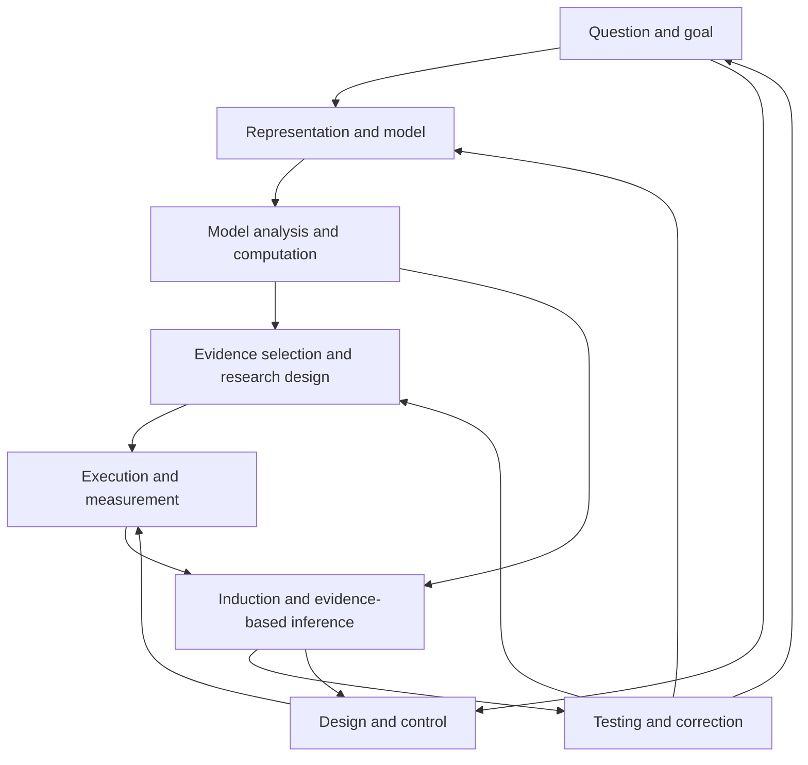

**TL;DR**

- Solving a problem after the model has been given covers only part of research. Problem formation, variable selection, theory construction, measurement, and correction also need to be evaluated separately.

- This article breaks scientific exploration into nine mutually feeding activities. Exploration may proceed forward, backward, or by guessing first and verifying later; conclusions should be judged by the strength of the evidence actually obtained.

- A good evaluation gives the agent the key decisions, lets those choices produce observable consequences, and checks the claims against independent evidence. Closed-loop ability is especially visible when results disagree with expectations: can the agent find which step it needs to revisit and correct its work effectively?

When we discuss whether AI can do scientific research, we often start with outcomes that are easy to quantify: how many scientific questions it answers correctly, whether it can write a correct simulation, or whether it can reproduce a curve from a paper. These abilities clearly have great value. But if we want to use them to judge whether a system can advance research, we also need to know which decisions the task has already made for it and which uncertainties it leaves to the system. This should make us ask whether other parts of scientific exploration still lack corresponding evaluations.

Consider a physical system. A physicist may write down a Hamiltonian and use it to calculate the ground-state energy. An agent may already be good at choosing a suitable wave-function representation or diagnosing why a calculation fails to converge. But further upstream, human researchers still have to decide which Hamiltonian should describe the actual system. Further downstream, they must connect the calculated result to a measurable signal and determine where a disagreement between experiment and theory comes from.

I would like to discuss these abilities with a finer-grained framework: **break scientific exploration into nine connected cognitive and practical activities, then examine which activities an evaluation actually asks the agent to perform and how those activities connect to one another.**

This is a map for analyzing tasks and designing evaluations. The nine activities can overlap and recur; their numbers do not imply a fixed order. The main examples here come from physics, with the goal of turning “research ability” into concrete, testable requirements.

# I. Nine activities in scientific exploration

## 1. Problem formation and goal definition

The starting point of research is often not a fully written question. It is often a break from the boundary of what we currently understand: an anomaly in an experimental observation, a new self-consistent theoretical explanation for a phenomenon, or a new record for the precision of an existing computational method.

The researcher has to turn that opening into a question that can drive work forward: What is genuinely unknown? Which judgment would solving it change? How strong a conclusion can the current conditions support?

For example, an anomalous scaling pattern in a set of numerical results could motivate several different goals: confirming whether a new phase transition really exists, checking for finite-size effects, or diagnosing whether an algorithm fails near the critical region. Different goals lead to different subsequent work. The difficult part is deciding **what is genuinely unknown**.

To evaluate this ability, provide context, existing evidence, and resource constraints, and ask the agent to propose a testable question and explain which results would change the current picture. Evaluation should consider the question’s significance, feasibility, and follow-up evidence; it should not simply reward a grand-sounding topic.

## 2. Representation and concept formation

After defining the question, the researcher must decide which language to use to describe it. In practice, this activity is often mixed with the third and fourth activities below.

Which variables are worth keeping? Microscopic particles, collective-mode excitations, or an order parameter? At what scale should the problem be studied? Which details can be temporarily ignored?

In many-body computation, choosing a basis, tensor network, or parameterized wave function affects which correlations can be represented effectively. In a phase-transition study, finding an appropriate order parameter may make clear structure emerge from data that initially look entangled.

An evaluation should test whether the representation preserves the minimum information the task needs, whether it supports model building and explanation, and what cost it pays in complexity and scope. Merely picking a variable and giving it a name is not yet concept formation.

## 3. Description, induction, and evidence-based inference

Physics is an experimental science. Repeated experimental data can reveal stable structure from which preliminary regularities can be inferred.

This includes identifying trends, estimating parameters, finding scaling relations, comparing candidate explanations, and quantifying uncertainty. The data may come from experiments, observations, or numerical simulations.

For example, a finite-size calculation may show a peak. We then need to determine whether that peak goes to zero as the system grows.

The deliverable from this activity should include both a conclusion and its evidential boundary: which judgments are robust, which depend on assumptions, and which candidate models the current data cannot distinguish.

## 4. Theory construction and explanation

Regularities need to be organized into models, mechanisms, or principles before they can produce further testable consequences.

Physical modeling can start from microscopic interactions and first principles, or it can begin “halfway” from symmetries, consistency, conservation laws, and scale separation. Phenomenological models, effective theories, and constraints on the space of admissible theories all belong to this activity.

For example, a researcher may propose an additional interaction term based on an observation, or judge that a low-energy description has omitted a necessary degree of freedom. A model should be tested through its explanatory scope, predictive power, complexity, and domain of validity.

The same data may permit multiple models. An evaluation therefore cannot use “looks the same as the reference formula” as its standard. It should test genuine understanding—for example, whether two descriptions are equivalent under an allowed basis transformation, or whether they are indistinguishable over a specified observational range.

## 5. Model analysis and computational solution

Given, or provisionally choosing, a model, how do we obtain conclusions from it that can be tested experimentally?

The name “model analysis and computational solution” is somewhat inadequate. In real research, different models can be approached in many ways: analytic derivation, physically informed guesses or estimates, and numerical simulation. More specifically, one might use random sampling, variational methods, or heuristic search.

Consider variational Monte Carlo for finding a ground state. Given H, choose a parameterized trial state ψθ and optimize the energy expectation:

> E(θ) = ⟨ψθ|H|ψθ⟩ / ⟨ψθ|ψθ⟩

This expression hides several distinct pieces of work: choosing a family of wave functions that can express the target correlations, using Monte Carlo to estimate the energy and its gradient, adjusting parameters to find a lower-energy state, and checking how much limitation comes from sampling, optimization, and representational capacity. Representative work on neural-network quantum states combines a new variational representation with solving a many-body problem; see [Carleo and Troyer](https://arxiv.org/abs/1606.02318).

We must distinguish three things: **finding a lower-energy state, reliably estimating its energy, and proving that it is the ground state.**

For a valid trial state, an exact energy expectation gives an upper bound on the ground-state energy. An estimate from finite sampling also contains statistical error, so every estimate cannot be treated as a strict upper bound. A heuristic optimizer finding a very good candidate state does not automatically prove global optimality.

Monte Carlo itself is not the same as optimization: it can be used to estimate an average under a fixed distribution. Which activity a particular algorithm belongs to depends on the scientific purpose it serves, so here we classify it broadly under model analysis and computational solution.

## 6. Evidence selection and research design

Once a model yields an inferable conclusion, we need to design an experiment to test it. Or, often earlier—when an unexpected experimental result appears at the first step—we should not rush to explore a new conclusion; we should first make sure the experiment can be reproduced. Similarly, when two mechanisms can explain the existing data, collecting more data under the same conditions may not help. A more valuable action might be to change the direction of a magnetic field, increase a system size, or measure a correlation function that distinguishes the predictions.

This activity includes experimental design, observation strategy, numerical-experiment design, and allocating a budget among candidate actions.

A good evaluation of experimental design should make choices have real consequences: the agent may have only a limited number of experimental-design attempts, and each validation costs something. The evaluation should check both what it established and whether it used limited resources to obtain decisive evidence.

## 7. Experimental execution and observational measurement

After deciding what to measure, the researcher still has to turn the physical process into trustworthy data.

Sample preparation, manipulation, instrument calibration, background subtraction, signal extraction, drift monitoring, and systematic-error control all affect the conclusion. Knowing that a response function should be measured is different from being able to measure it reliably.

For example, a change in a spectral line may come from the object being studied, or from a change in resolution, contact conditions, or instrument drift. The measurement model is therefore part of the inference chain.

This ability can be evaluated through a real experimental interface, raw-data processing tasks, or a simulated environment with an instrument model. When interpreting results, make clear which parts the environment actually covers: performance on cleaned data does not by itself show that a system can prepare samples or calibrate instruments.

## 8. Critique, testing, and correction

As research progresses, results that disagree with expectations are common. The key is whether the researcher can localize the error and choose an appropriate correction.

Return to the variational ground-state example: a stalled energy may come from optimization difficulty; error bars that are too small may come from ignoring sampling autocorrelation; if changing the optimizer does not help, the wave-function representation may need inspection. If the computation itself is reliable but the prediction continues to disagree with experiment, the measurement chain and physical model need further examination.

These diagnoses call for different actions. Blindly increasing computation may not solve a missing-model problem; modifying the Hamiltonian too early may hide a program bug.

An evaluation can provide a research process with controllable faults and ask the agent to diagnose, choose checks, and implement corrections. Saying “we need more data” is not the important part; what matters is whether the subsequent action removes a specific uncertainty.

## 9. Design, implementation, and control

Scientific research also pursues target systems or target behavior: preparing a particular quantum state, achieving a target material property, designing a device geometry, or constructing an instrument that enables a new measurement.

This work requires searching backward for parameters and plans, then adjusting them in response to feedback from implementation.

Optimization can mean different things here. With H fixed, optimizing ψθ to estimate a ground state is mainly model solving; adjusting device parameters to obtain a target response is mainly design and control. Choosing a measurement to distinguish mechanisms is mainly research design.

The three activities can share algorithms, but their purposes and acceptance criteria differ. For a design task, in addition to performance under ideal conditions, we need to check whether constraints are satisfied and whether the plan is robust to perturbations, errors, and implementation conditions.

# II. Paths to an answer and grounds for establishing a conclusion

Research can move from a hypothesis to a result, search backward from a target for the conditions that produce it, search inward from both ends for a shared intermediate structure, or guess an answer first and then verify it.

These paths cannot all be classified as deduction. We need to distinguish **discovery strategy** from **the evidential relationship**.

| Exploration path | Reasoning activity involved | What must ultimately be checked |
| - | - | - |
| Deriving consequences from a model | Deduction, approximate analysis, or numerical solution | Premises, derivation, errors, and domain of validity |
| Proposing an explanation from a phenomenon | Abduction: finding a hypothesis that could produce the phenomenon | Alternative explanations and discriminating predictions |
| Working backward from a goal | Reverse construction or proof search | Whether the conditions found are actually sufficient and hold |
| Moving inward from both ends | Bidirectional search and constraint matching | Whether the intermediate structure connects the two ends effectively |
| Guessing a conclusion and then verifying it | Conjecture generation and testing | Whether the verification gives a proof or only limited support |

For example, to prove C, first find B sufficient to imply C, then prove that A implies B, ultimately obtaining A ⇒ B ⇒ C. This remains deduction even though the discovery process began at the conclusion.

But if we observe C and hypothesize that A could produce C, then propose A on that basis, this is usually abduction. Other hypotheses may explain the same result.

For a finite-dimensional Hermitian Hamiltonian, a researcher may first guess a nonzero state ψ and then verify H|ψ⟩ = E|ψ⟩ rigorously, thereby establishing that it is an eigenstate. If they also prove that H − EI is positive semidefinite, they can establish that it is a ground state. The process of discovering the answer does not need to replay a standard derivation path.

Mathematical research likewise includes conjecture, analogy, numerical exploration, and reverse search. Physics research also has to handle the relationship between a model and the actual system: once the reasoning is internally valid, at what scale and precision does it apply?

This leads to a direct requirement for evaluation: **allow different discovery paths while distinguishing rigorously what kind of support a conclusion has received.**

# III. How a scientific research loop connects these activities

The nine activities feed back into one another in many ways. A common empirical research path can be drawn as follows; “representation and model” combines two activities here:

A new observation, computational result, or anomaly can become the entry point. Researchers may also skip some activities, return to an earlier question, or split a large question into several smaller loops.

At least three loops should be distinguished.

**The computational-solving loop** takes place inside a provisional model: adjust the representation, sampling, and algorithm to obtain a more reliable model result. It requires checking discretization, truncation, statistical fluctuations, and optimization error. This is probably also the most common loop in current agent evaluations.

**The theory–empiricism loop** connects a model to the actual system: make a prediction, obtain an observation, compare the difference, and then judge the model and its domain of validity. Numerical convergence cannot solve every problem of model validity.

**The design-and-control loop** revolves around target behavior: propose a plan, simulate or implement it, measure its effect, and adjust the design. Simulated performance still has to face real constraints and model mismatch.

A rigorous result, a new algorithm, or an instrument improvement can each complete only one segment and still constitute an independent contribution. An evaluation should state which segment it measures and which links it connects; every task need not traverse the entire process.

#

# IV. What the physics tasks in TB-Science actually cover

Based on the TB-Science submission [01b3c48](https://github.com/harbor-framework/terminal-bench-science/tree/01b3c488061353987d6407b170c2ffbc851802f2) from October 15, 2026, the five tasks in the `physics` directory mainly test numerical solution within a given physical model, parameter search, algorithm implementation, and device optimization.

| Task | Final deliverable | Main abilities tested | Keyword | Corresponding step in our framework |
| - | - | - | - | - |
| [Frustrated Heisenberg neural-network quantum state](https://github.com/harbor-framework/terminal-bench-science/blob/01b3c488061353987d6407b170c2ffbc851802f2/tasks/physical-sciences/physics/frustrated-heisenberg-nqs/instruction.md) | Keep the RBM architecture fixed and lower the variational energy | Variational optimization, numerical many-body computation | Optimization | **Activity 5: Model solving** |
| [Three-dimensional spin-glass ground state](https://github.com/harbor-framework/terminal-bench-science/blob/01b3c488061353987d6407b170c2ffbc851802f2/tasks/physical-sciences/physics/spin-glass-groundstate/instruction.md) | Submit six spin configurations that reach the ground-state energy | Discrete global optimization | Search | **Activity 5: Model solving** |
| [Inverse lithography](https://github.com/harbor-framework/terminal-bench-science/blob/01b3c488061353987d6407b170c2ffbc851802f2/tasks/physical-sciences/physics/inverse-lithography/instruction.md) | Calibrate the hidden process and design a binary mask | Mechanism inference, experimental design, inverse design | Design | **Activity 4: Experimental or observational design; Activity 5: Model solving** |
| [Waveguide-index inversion](https://github.com/harbor-framework/terminal-bench-science/blob/01b3c488061353987d6407b170c2ffbc851802f2/tasks/physical-sciences/physics/inverse-waveguide-shape/instruction.md) | Write a solver that reconstructs the output field on unseen instances | Inverse problems, algorithm construction, model generalization | Modeling | **Activity 5: Model solving** |
| [Silicon grating coupler](https://github.com/harbor-framework/terminal-bench-science/blob/01b3c488061353987d6407b170c2ffbc851802f2/tasks/physical-sciences/physics/leaky-bloch-meep/instruction.md) | Submit device geometry and independently recompute its performance | Multi-constraint device optimization, numerical simulation | Design | **Activity 9: Design, implementation, and control** **Activity 5: Model solving** |

The common feature of these five tasks is that the physical model, basic degrees of freedom, input–output relationship, and acceptance criteria are largely specified in advance. The agent mainly searches parameters, runs simulations, implements algorithms, or optimizes an objective within the given model.

Inverse lithography and the silicon grating coupler contain some experimental-design or device-design elements, but their design spaces, objective functions, and evaluation criteria are still prescribed by the task. Overall, these tasks are closer to “completing a complex computational task within a given physical model” than to open-ended physics research.

For example, they rarely directly evaluate the following abilities:

- Formulating a new physical question from incomplete background;

- Choosing the measurement object, representation method, or effective variable autonomously;

- Comparing multiple mechanisms and proposing an explanatory theory;

- Designing the next experiment that can distinguish competing explanations;

- Discovering a model mismatch and deciding whether to replace the model;

- Explaining the physical meaning of a result rather than merely reaching a numerical threshold.

Therefore, successfully completing these physics tasks cannot be directly equated with carrying out physics research. A more accurate description is that these tasks mainly evaluate whether an agent can perform optimization, inversion, numerical computation, algorithm implementation, and device design within a given physical model. Most of them concentrate on our fifth activity, “model solving,” and cover the earlier activities of problem formation, variable selection, mechanism modeling, and experimental design only to a limited extent.

# V. How to turn the other eight activities in the research loop into executable evaluations

Four principles can guide the inclusion of the other eight activities:

- **Give the agent the key decisions.** To test problem formation, do not write the problem in advance; to test theory construction, leave real choices in the model structure.

- **Make decisions have consequences.** Specify the initial information, available operations, budget, and deliverable; let the agent act, then observe the result.

- **Test the corresponding claims with independent evidence.** Some activities are genuinely difficult to verify fully automatically. Retain expert evaluation for the parts that are difficult to accept automatically.

- **Separate activities first, then connect them.** We may need to distinguish the nine individual capabilities from whole-loop capability.

## How to write tasks for the eight activities

| Activity | Task and autonomous decision | Deliverable and acceptance |
| - | - | - |
| **Problem formation and goal definition** | Provide an anomalous observation and the existing consensus; let the agent choose which question is worth pursuing | Submit the question, criteria, and plan before limited exploration; separately evaluate significance, testability, and whether new evidence advances the judgment. |
| **Representation and concept formation** | Provide known conditions and a target question; let the agent choose which levels and quantities deserve attention | Under the same downstream model and budget, check information retained and complexity. |
| **Description, induction, and evidence-based inference** | Provide noisy repeated-experiment data; ask the agent to extract regularities, estimate parameters, and judge whether the evidence is sufficient | Submit analysis code, conclusions, and uncertainty; use held-out data to check predictions and multiple instances to check false positives, false negatives, and interval coverage. |
| **Theory construction and explanation** | Give the question, representation, description, and preliminary regularities; let the agent propose a theory autonomously | Submit the model, its mapping to observables, and its domain of validity; recognize physically equivalent descriptions. |
| **Evidence selection and research design** | Provide competing models that explain the initial data and a costly experimental interface; let the agent decide what to measure next | Execute the measurement and record queries; across multiple instances, compare discriminating reliability or predictive quality under equal budgets against a fixed-scan baseline. |
| **Experimental execution and observational measurement** | Before connecting to a wet lab, provide a virtual instrument with background and drift; let the agent choose settings, calibration, and repeated measurements to recover the sample signal | Submit raw records, calibration, and processing code; check bias, error intervals, and cost on new samples and instrument states. Scores correspond only to operations covered by the environment. |
| **Critique, testing, and correction** | Provide a process in which prediction and observation disagree; make similar anomalies arise from sampling, optimization, representation, model, or instrument problems, and include fault-free controls | The agent chooses checks and implements corrections; accept only if independent results improve, correct results are preserved, and unnecessary modifications do not occur. |
| **Design, implementation, and control** | Give a target state or device objective and physical constraints; let the agent choose executable parameters, control sequences, or feedback strategies | An independent protocol checks target completion, constraints, and cost. |

## From individual capabilities to a closed loop

We can increase autonomy around the same unknown question step by step: first analyze calibrated data, then build a model autonomously, then choose additional measurements, and finally include calibration, diagnosis, and question formation in the task. Sharing solvers and validation environments, while comparing “the agent autonomously completes a stage” with “the agent receives a verified intermediate result,” helps locate capability bottlenecks.

Every task need not traverse all nine activities. Start with a short “infer → choose a measurement → infer again” or “model → predict → diagnose → correct” loop, and check whether new evidence truly changes the next action. If we want to claim that a research strategy has improved, we should also keep the external acceptance protocol and budget comparable, then test transfer on independent new tasks.

# VII. What I ultimately want scientific evaluations to answer

I want scientific evaluations to gradually answer a more specific set of questions: Can an agent form a worthwhile research question from incomplete information? Can it build a sufficiently effective representation and model? Can it obtain a reliable result under a limited budget and choose the next action that could change its judgment? When results conflict, can it localize the problem and revise its work in response to evidence?

The nine activities provide a shared language for discussing these questions. The value of a scientific task lies in whether it preserves real choices, costs, uncertainty, and feedback.
