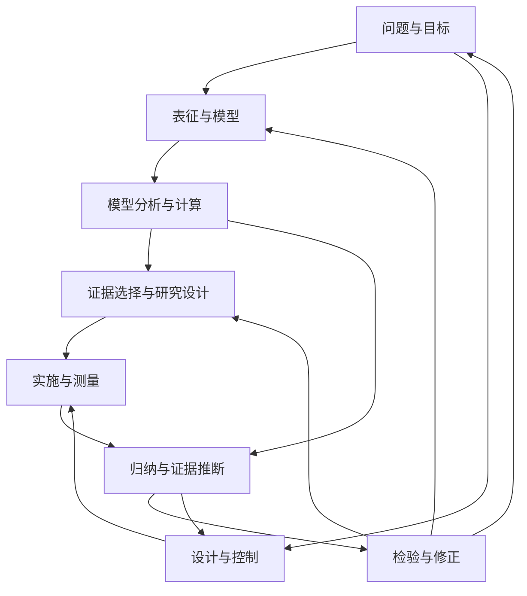

**TL;DR**

- 给定模型后的求解，只覆盖科研的一部分。问题提出、变量选择、理论构造、测量与修正，也需要被单独评测。

- 本文将科学探索拆成九类相互反馈的活动。探索可以正推、反推或先猜后验，结论则应按实际证据的强度来评价。

- 好的评测要把关键决定交给 agent，让选择产生可观察的后果，并用独立证据验收。闭环能力尤其体现在：结果不符预期时，能否找到该回到的环节并有效修正。

讨论 AI 能否做科学研究时，我们经常从容易量化的结果开始：它能答对多少道科学问题，能否写出正确的模拟程序，能否复现论文中的一条曲线。这些能力显然有很高价值。但如果要据此判断一个系统能否推动研究，我们还需要知道：题目已经替它做了哪些决定，又把哪些不确定性留给了它？这值得我们注意科学探索其他的环节是否还欠缺相应的评测。

举个例子。描述一个物理系统物理学家会写出 Hamiltonian，从它出发可以计算基态能量；现在Agent可能已经很适合选择合适的波函数表示、判断计算为何不收敛等。但其实再往前，人类研究者还要决定应该用什么 Hamiltonian 描述实际系统；再往后，还要把计算结果连接到可测量的信号，并判断实验与理论的不一致来自哪里。

我希望用一个更细的框架讨论这些能力：**把科学探索拆成九类相互联系的认知与实践活动，再检查评测真正要求 agent 完成了哪些活动，以及活动之间的相互联系。**

这是一张用于分析任务和设计评测的地图。九类活动可以重叠，也可以反复发生；编号不表示固定顺序。本文以物理研究为主要例子，关注如何让“科研能力”成为具体、可检验的要求。

# 一 科学探索中的九类活动

## 1 问题形成与目标界定

研究的起点常常还不是一个写好的问题，它往往是打破我们现有的认知边界：比如发现一处实验观测到的异常、针对一个现象重新提出一种新的自洽的理论解释，或者刷新现有计算方法的最高精度等。

研究者需要把它转化为可以推进的问题：真正未知的是什么？解决它会改变哪个判断？现有条件能支持多强的结论？

例如，一组数值结果出现异常标度，可以引出几个不同目标：确认是否真的存在新相变、或者去检查有限尺寸效应，或者诊断算法在临界区是否失效。目标不同，后续工作也会不同。难点就在于确定**真正未知的是什么**。

评测这一能力，可以提供背景、已有证据与资源约束，让 agent 提出可检验的问题，并解释哪些结果会改变当前认识。评价要关注问题的意义、可行性与后续证据，不能仅奖励一个听起来宏大的题目。

## 2 表征与概念形成

确定问题以后，还要决定用什么语言描述它。其实这一步和下面的第三步第四步可能往往是混合在一起的。

哪些变量值得保留？用微观粒子、集体模激发、序参量？在哪个尺度上工作？哪些细节可以暂时忽略？

在多体计算中，选择基底、张量网络或参数化波函数，会影响哪些关联能够被有效表达。在相变研究中，找到合适的序参量，可能使原本混杂的数据呈现出清楚的结构。

评测应检验表征是否保留了任务需要的最简信息、能否支持建立模型做出解释，以及它在复杂度和适用范围上付出了什么代价。仅仅随便抓一个变量起个名字，还没有完成概念构造。

## 3 描述、归纳与证据推断

物理是一门实验科学，多次重复实验数据下，其中有什么稳定结构可以初步归纳出一些规律。

这包括识别趋势、估计参数、寻找标度关系、比较候选解释，以及量化不确定性。数据可以来自实验、观测，也可以来自数值模拟。

例如，有限尺寸计算中出现一个峰值，需要进一步判断它是否随系统增大零。

这一环节的交付物应包含结论及其证据边界：哪些判断稳健，哪些依赖假设，哪些候选模型目前还无法区分。

## 4 理论构造与解释

规律需要被组织成模型、机制或原则，才能进一步产生可检验的后果。

物理建模可以从微观相互作用第一性出发，也可以从对称性、一致性、守恒律和尺度分离“半路”出发。现象学模型、有效理论和对允许理论空间的约束，都属于这一活动。

例如，研究者可能根据观测提出额外的相互作用项，也可能判断某个低能描述遗漏了必要自由度。模型的价值要通过解释范围、预测能力、复杂度与适用条件来检验。

同一组数据可能允许多个模型。因此，评测不能把“与参考公式长得相同”作为标准。二要真正理解，比如两个描述通过允许的基变换等价，或者在指定观测范围内不可区分，这是真正的等价。

## 5 模型分析与计算求解

给定或暂定一个模型，我们怎样找到它的和可实验检验的结论？

这里采用“模型分析与计算求解”这个名称可能有些词穷了，真实研究中给定不同的模型有多种求解路径：比如解析推导、物理直接猜想或估算、数值模拟。甚至更具体一些比如可能用到随机采样、变分方法与启发式搜索等。

以变分蒙特卡罗求基态为例。给定 H，选择参数化试探态 ψθ，优化能量期望：

> E(θ) = ⟨ψθ|H|ψθ⟩ / ⟨ψθ|ψθ⟩

这个表达式背后包含几项不同工作：选择能表达目标关联的波函数族，用蒙特卡罗估计能量与梯度，调整参数寻找更低能的态，再检查采样、优化和表示能力分别造成了多大限制。神经网络量子态的代表性工作，就是把新的变分表示与多体问题求解结合起来的例子。[Carleo 与 Troyer](https://arxiv.org/abs/1606.02318)

这里必须分清三件事：**找到更低能的态，可靠地估计它的能量，以及证明它就是基态。**

对合法试探态，精确的能量期望给出基态能量的上界；有限采样得到的估计值还带有统计误差，不能把每次估计都当成严格上界。启发式优化找到一个很好的候选态，也不自动给出全局最优证明。

蒙特卡罗本身也不等于优化：它可以用于估计固定分布下的平均量。具体算法属于哪个环节，要看它承担的科研目的，所以这里我们也把它笼统的归类到模型分析与计算求解。

## 6 证据选择与研究设计

模型有了可推断的结论后需要设计实验验证，或者往往在更早比如第一步出现超出预料的实验结果时候，我们不应该兴奋去探究新结论，而应该先确保实验复现。以及比如两个机制都能解释已有数据，继续收集相同条件下的数据未必有效。更有价值的行动，可能是改变磁场方向、增加某个系统尺寸，或者测量一个能区分两种预测的关联函数。

这一活动包括实验设计、观测策略、数值实验设计，以及预算在不同候选行动之间的分配。

好的实验设计的评测应让选择产生真实后果：agent 只能进行有限次数的实验设计方案，每次方案验证都有成本。最终既检查它建立了什么，也检查它是否用有限资源获得了关键证据。

## 7 实验实施与观测测量

决定测什么以后，还需要把物理过程转化为可信的数据。

制样、操控、仪器校准、背景扣除、信号提取、漂移监测和系统误差控制，都会影响结论。知道应该测某个响应函数，与能够可靠地测出它，是不同的能力。

例如，一条谱线的变化可能来自研究对象，也可能来自分辨率变化、接触条件或仪器漂移。测量模型因此是推断链条的一部分。

这一能力可以通过真实实验接口、原始数据处理任务或带仪器模型的模拟环境来评测。解释结果时，需要明确环境实际覆盖了哪些环节：处理已清洗数据的成绩，不能直接说明系统具有制样与校准能力。

## 8 批判、检验与修正

科研推进过程中，结果与预期不一致是常见情况。关键在于能否定位错误，并选择合适的修正。

回到变分求基态：能量停滞，可能来自优化困难；误差条过小，可能来自忽略采样自相关；换优化器也没有改善，可能需要检查波函数表示。如果计算本身可靠，而预测持续偏离实验，就要进一步检查测量链条与物理模型。

这些诊断对应不同的行动。盲目增加计算量，未必能够解决模型遗漏的问题；过早修改 Hamiltonian，也可能掩盖程序错误。

评测可以提供带有可控故障的研究过程，让 Agent 提出诊断、选择检查并实施修正。是否说出了“需要更多数据”并不关键，后续行动能否消除具体的不确定性才关键。

## 9 设计、实现与控制

科学研究也会追求某种目标系统或目标行为：制备特定量子态、实现目标材料性质、设计器件结构，或者构造能够完成新测量的仪器。

这类工作需要反向寻找参数与方案，并在实现结果的反馈中调整。

同样是优化，固定 H 后优化 ψθ 以估计基态，主要属于模型求解；调整器件参数以获得目标响应，主要属于设计与控制。选择一次测量来区分机制，则主要属于研究设计。

三者可以共享算法，但任务目的和验收标准不同。对设计任务，除了理想条件下的性能，还需要检查约束是否满足，以及方案对扰动、误差和实现条件是否稳健。

# 二 发现答案的路径与确立结论的依据

科研过程可以从假设走向结果，也可以从目标往回寻找条件，从两端寻找共同的中间结构，或者先猜出答案再验证。

这些路径不能全部归为演绎。需要区分**发现策略**和**证据关系**。

| 探索路径 | 其中的推理活动 | 最终需要检查什么 |
| - | - | - |
| 从模型推出后果 | 演绎、近似分析或数值求解 | 前提、推导、误差与适用条件 |
| 从现象提出解释 | 溯因，即寻找可能产生现象的假设 | 替代解释与区分性预测 |
| 从目标倒推条件 | 逆向构造或证明搜索 | 找到的条件是否真的足够且成立 |
| 从两端向中间推进 | 双向搜索与约束匹配 | 中间结构能否把两端有效连接 |
| 先猜结论再验证 | 猜想生成与检验 | 验证究竟给出了证明还是有限支持 |

例如，为了证明 C，先寻找足以推出 C 的 B，再证明 A 能推出 B，最终得到 A ⇒ B ⇒ C。这仍然是演绎，尽管发现过程从结论开始。

但如果观察到 C，而假设 A 能够产生 C，就据此提出 A，这通常是溯因。其他假设也可能解释同一结果。

对一个有限维厄米 Hamiltonian，研究者可以先猜出非零态 ψ，再严格验证 H|ψ⟩ = E|ψ⟩，从而确立它是本征态。若还证明 H − EI 为半正定，就能确立它是基态。发现答案的过程没有必要重演某条标准推导路线。

数学研究同样包含猜想、类比、数值探索和逆向搜索。物理研究还需要处理模型与实际系统的关系：推理内部成立以后，它在什么尺度和精度下适用？

这对评测提出了一个直接要求：**允许不同的发现路径，同时严格区分结论获得了何种支持。**&#x20;

# 三 科研闭环如何连接这些活动

九类活动之间存在多种反馈。一条常见的经验研究路径可以画成下面这样，其中“表征与模型”合并了两类活动：

新观测、新计算结果或异常现象，都可以成为入口。研究者也可能跳过某些环节，回到先前的问题，或者把一个大问题拆成几个较小的循环。

其中至少需要区分三个循环。

**计算求解的循环**发生在暂定模型内部：调整表示、采样与算法，得到更可靠的模型结果。这里需要判断离散化、截断、统计波动和优化误差。这个应该也是现有 Agent 评测中最多的循环类型。

**理论与经验的循环**连接模型和实际系统：建立预测、获得观测、比较差异，再判断模型及其适用范围。数值收敛解决不了所有模型有效性问题。

**设计与控制的循环**围绕目标行为展开：提出方案、模拟或实现、测量效果，再调整设计。模拟中的性能还需要面对实际约束与模型偏差。

一项严格结果、一种新算法或一次仪器改进，都可以只完成其中一段而构成独立贡献。评测应说明它测了哪一段、连接了哪些环节，不必要求每道题都走完全部流程。

#

# 四 TB-Science 的物理题实际覆盖了什么

基于 TB-Science 在 2026 年 10 月 15 日的提交 [01b3c48](https://github.com/harbor-framework/terminal-bench-science/tree/01b3c488061353987d6407b170c2ffbc851802f2)，`physics` 目录中的五道题主要考察在给定物理模型中的数值求解、参数搜索、算法实现和器件优化。

| 任务 | 最终交付 | 主要考察能力 | 关键词 | 对应我们提出的步骤 |
| - | - | - | - | - |
| [受挫 Heisenberg 神经网络量子态](https://github.com/harbor-framework/terminal-bench-science/blob/01b3c488061353987d6407b170c2ffbc851802f2/tasks/physical-sciences/physics/frustrated-heisenberg-nqs/instruction.md) | 固定 RBM 架构并降低变分能量 | 变分优化、数值多体计算 | 优化 | **第五类：模型求解** |
| [三维自旋玻璃基态](https://github.com/harbor-framework/terminal-bench-science/blob/01b3c488061353987d6407b170c2ffbc851802f2/tasks/physical-sciences/physics/spin-glass-groundstate/instruction.md) | 提交六组达到基态能量的自旋构型 | 离散全局优化 | 搜索 | **第五类：模型求解** |
| [逆向光刻](https://github.com/harbor-framework/terminal-bench-science/blob/01b3c488061353987d6407b170c2ffbc851802f2/tasks/physical-sciences/physics/inverse-lithography/instruction.md) | 校准隐藏工艺并设计二值掩模 | 机制推断、实验设计、逆向设计 | 设计 | **第四类：实验或观测设计；第五步：模型求解** |
| [波导折射率反演](https://github.com/harbor-framework/terminal-bench-science/blob/01b3c488061353987d6407b170c2ffbc851802f2/tasks/physical-sciences/physics/inverse-waveguide-shape/instruction.md) | 编写求解器，在未知实例上重建输出场 | 逆问题、算法构造、模型泛化 | 建模 | **第五类：模型求解** |
| [硅光栅耦合器](https://github.com/harbor-framework/terminal-bench-science/blob/01b3c488061353987d6407b170c2ffbc851802f2/tasks/physical-sciences/physics/leaky-bloch-meep/instruction.md) | 提交器件几何并独立重算性能 | 多约束器件优化、数值仿真 | 设计 | **第九类：设计、实现与控制** **第五步：模型求解** |

这五道题的共同特点是：物理模型、基本自由度、输入输出关系和验收标准大多已经给定，agent 主要负责在既定模型中搜索参数、运行仿真、实现算法或优化目标。

其中，逆向光刻和硅光栅耦合器包含一定的实验设计或器件设计成分，但设计空间、目标函数和评价标准仍由任务预先规定。整体而言，这些题更接近“在给定物理模型中完成复杂计算任务”，而不是开放式的物理研究。

举个例子它们较少直接评测以下能力：

- 从不完整背景中提出新的物理问题；

- 自主选择测量对象、表征方法或有效变量；

- 比较多个机制并提出具有解释力的理论；

- 设计能够区分竞争性解释的下一次实验；

- 发现模型失配并决定是否更换模型；

- 解释结果的物理意义，而不仅是达到数值门槛。

因此，成功完成这些物理题不能直接等同于完成了物理学研究。更准确的表述是：这些任务主要评测 agent 能否在给定物理模型中完成优化、反演、数值计算、算法实现和器件设计，且其中大多数任务集中在我们提出的第五步“模型求解”，对前面的问题提出、变量选择、机制建模和实验设计环节覆盖有限。

# 五 怎样把科研闭环中其他八类活动变成可执行的评测

把其他八类活动纳入评测，可以遵循四个原则：

- **把关键决定交给 agent。** 想测问题提出，就不要预先写好问题；想测理论构造，就要让模型结构存在选择空间。

- **让决定产生实际后果。** 明确初始信息、可用操作、预算和交付物，让 agent 执行，再观察结果。

- **用独立证据检验相应主张。** 有些类活动确实很难直接想全自动化的verifer了，难以自动验收的部分保留专家评价。

- **先分项，再连接。** 可能还要区分上述九类单项能力与整体闭环能力。

## 八类活动怎样出题

| 活动 | 任务与自主决定 | 交付物与验收 |
| - | - | - |
| **问题形成与目标界定** | 提供异常发现和已有共识，让 agent 自己选择值得追踪的问题 | 先提交问题、判据与计划，再执行有限探索；分别评价问题的意义、可检验性，以及新增证据是否推进了判断。 |
| **表征与概念形成** | 提供已知条件和目标问题，让 agent 自己选择需要关注哪些层级和量。 | 在相同下游模型与预算下，检查信息保留与复杂度。 |
| **描述、归纳与证据推断** | 提供带噪声的重复实验数据，让 agent 提取规律、估计参数，并判断证据是否足够。 | 提交分析程序、结论及不确定性；用保留数据检查预测，在多实例上检查误报、漏报及区间覆盖表现。 |
| **理论构造与解释** | 给出问题，表征和描述和初步归纳出的规律，让 agent自主提出理论。 | 提交模型、观测量映射和适用范围，认可物理上等价的描述。 |
| **证据选择与研究设计** | 提供能解释初始数据的竞争模型及带成本的实验接口，让 agent 决定下一次测什么。 | 实际执行测量并记录查询；在多个实例中，比较相同预算下的判别可靠度或预测质量，并与固定扫描等策略对照。 |
| **实验实施与观测测量** | 未接入wet实验室前提供带背景与漂移的虚拟仪器，让 agent 选择设置、校准与重复测量，恢复样品信号。 | 提交原始记录、校准和处理程序；在新样品及仪器状态下检查偏差、误差区间与成本。成绩只对应环境实际覆盖的操作。 |
| **批判、检验与修正** | 提供预测与观测不一致的研究过程，让相似异常分别来自采样、优化、表示、模型或仪器问题，并加入无故障对照。 | agent 选择检查并实施修正；验收独立结果是否改善、正确结果是否保留，以及是否发生无谓修改。 |
| **设计、实现与控制** | 给出目标态或器件目标及物理约束，让 agent 选择可执行参数、控制序列或反馈策略。 | 由独立协议检验目标完成度、约束和成本 |

## 从单项能力走向闭环

可以围绕同一个未知问题逐步增加自主权：先分析已校准数据，再自主构模，再选择追加测量，最后把校准、诊断和问题提出纳入任务。共享求解器与验证环境，并比较“自主完成某环节”与“提供经验证的中间结果”两种条件，有助于定位能力瓶颈。

不必让每道题走完九类活动。先做“推断—选测量—再推断”或“建模—预测—诊断—修正”的短循环，检查新证据是否真正改变后续行动。如果要进一步声称研究策略得到改进，还应保持外部验收协议与预算可比，在独立的新任务上检验迁移效果。

# 七 我希望科研评测最终回答的问题

我希望科研评测能够逐渐回答一组更具体的问题：agent 能否从不完整的信息中形成值得研究的问题？能否建立足够有效的表示与模型？能否在有限预算内得到可靠结果，并选择能改变判断的下一步行动？当结果出现矛盾时，它能否定位问题，并根据证据修正自己的工作？

九类活动给出了讨论这些问题的共同语言。科研任务的价值，则体现在它是否保留了真实的选择、代价、不确定性和反馈。

