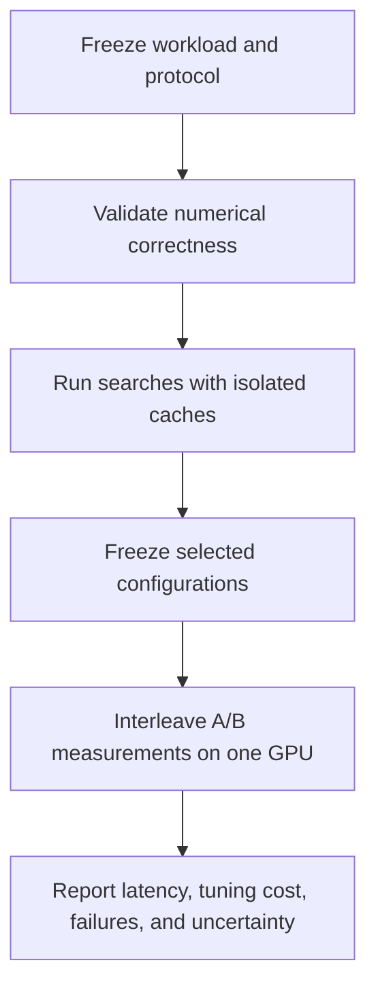

“A configuration is 5% faster” is first a measurement claim. Does the number describe GPU execution, a Python call, or compilation and search? Are inputs resident in cache? Do both sides use the same timer?

This note grew out of a MetaX C500 experiment with FlagGems/FlagTune and a subsequent review of FlagTree, Helion, and Triton. It describes a protocol that can be frozen, audited, and reproduced. Historical observations, source-level findings, and proposed procedures have different evidential status throughout.

## Define three measurements

| Metric | Question | Boundary |
|---|---|---|
| Complete GPU operation latency | How fast does the compiled operation execute? | Include all required kernels, reductions, and device dependencies |
| Host-side call cost | What does calling the implementation cost the application? | Specify Python, allocation, submission, and synchronization |
| Total tuning wall time | How long does choosing a configuration take? | Include proposals, model inference, compilation, checks, warmup, timing, and failures |

A split-K partial kernel is not a complete matrix multiplication. Faster search does not imply proportionally faster kernels. Workload semantics, dtype, layout, accumulation precision, and numerical checks must agree first.

## There is more than one official benchmark

The reviewed FlagGems revision is `2d50c88c91e590ec8246c0ea20977aaeef9edd85`; the FlagTree Python source revision is `2dc31aecc883ab04c8f7a1c1dab8b321ae8ed109`.

In [FlagGems benchmark/base.py](https://github.com/flagos-ai/FlagGems/blob/2d50c88c91e590ec8246c0ea20977aaeef9edd85/benchmark/base.py), `OPERATOR` measures a Python loop bracketed by synchronization. The ordinary non-Ascend `KERNEL` mode calls `triton.testing.do_bench`, whose behavior depends on the installed vendor fork. `CUDAGRAPH` replays captured work. `WRAPPER` focuses on host submission time rather than synchronized completion.

FlagTune `pretune` runs configuration selection and a fresh selected-configuration measurement. Its [rebench command](https://github.com/flagos-ai/FlagGems/blob/2d50c88c91e590ec8246c0ea20977aaeef9edd85/src/flag_gems/flagtune/offline/cli/rebench.py) measures both selected configurations in one process on one device, alternating their order. This revision defaults to nine trials per sweep and three sweeps, with medians within and across sweeps.

“Official benchmark” is therefore not a complete protocol description.

## A correction: recorded warmup is not necessarily executed warmup

We initially read `warmup_ms=25` in a receipt as evidence of 25 milliseconds of warmup. Source inspection requires correcting that description.

The ordinary graph-replay branch in the pinned [benchmark_protocol.py](https://github.com/flagos-ai/FlagTree/blob/2dc31aecc883ab04c8f7a1c1dab8b321ae8ed109/python/triton/flagtune/runtime/benchmark_protocol.py) forwards `rep`, `quantiles`, and optionally `n_retries`, but not `warmup_ms`. The corresponding [do_bench_cudagraph](https://github.com/flagos-ai/FlagTree/blob/2dc31aecc883ab04c8f7a1c1dab8b321ae8ed109/python/triton/testing.py) has no warmup argument: it performs an initial call, five estimation calls, graph capture, and timed replays.

A [CPU-only forwarding probe](/assets/gpu-benchmark-protocol/probe_dispatch.py) accompanies this article. It replaces the underlying timer with a stub and records its arguments. The returned values are sentinels, not performance results. This verifies forwarding behavior, not GPU thermal or clock stability.

The historical experiment used a distributed compiler wheel plus pinned FlagTune Python modules, rather than a complete build of the pinned FlagTree revision. Inspecting the local source does not establish the exact implementation inside that wheel. Future runs must retain the installed timer source or its hash. This remains a limitation of the historical evidence.

## Three distinct caches

The compilation cache controls recompilation. The tuning database can return a configuration or previously measured latency. GPU data caches affect where inputs are read from.

An empty compilation cache and warm L2 can coexist. Separate tuning databases do not establish separate compilation caches.

The pinned ordinary Triton `do_bench` clears cache before each timed call. The graph-replay path does not perform the same per-call L2 clearing. Actual residency still depends on working-set size; graph replay does not guarantee that every operand fits in L2. These regimes can change both absolute times and configuration rankings.

Correctness tests can also warm compilation caches. Cold-compilation experiments should run preflight correctness checks in a separate cache directory, distinguishing application-controlled caches from driver-internal state.

## A useful but limited example

On October 24, 2026, a 64GB MetaX C500 ran contiguous BF16 `1024×1024 @ 1024×1024`, with FP32 accumulation and BF16 output. The environment used PyTorch `2.8.0+metax3.7.0.7`, the official FlagTree wheel `0.7.0.post2+metax3.6`, and the pinned FlagTune modules above.

The official Default receipt reported approximately **32.535 µs** for the selected configuration and **2.203 seconds** for its tuning phase. It selected `BLOCK_M=64, BLOCK_N=64, BLOCK_K=32, num_warps=4, num_stages=2, pipeline=cpasync`. Correctness had already run, so the tuning time is not a cold-compilation search cost.

The expanded domain contained 2,160 raw configurations; applying the pinned official pruning function to this shape retained 430. Collection stopped at a ten-minute limit. The database retained 424 records: 371 finite timings and 53 nonfinite timings, with six configurations unmeasured. No complete final worker receipt was produced. The accompanying data is a derived, read-only export from the official SQLite BenchmarkCache.

| Change only one field from the anchor | Latency in the same exploratory collection |
|---|---:|
| Anchor | 32.516 µs |
| BLOCK_K: 32 → 64 | 54.787 µs |
| num_warps: 4 → 8 | 51.147 µs |
| num_stages: 2 → 3 | 39.080 µs |

These observations motivate hypotheses about resource trade-offs. They do not establish a bottleneck: neighbors were not individually correctness-checked and independently rebenchmarked. A finite timing does not prove numerical correctness; a nonfinite timing does not establish mathematical illegality.

Default selected the fastest configuration in the measured subset. Missing records prevent a claim of global optimality.

An official A/A rebench of the same configuration reported approximately 100.003% relative throughput and 0.026% sweep spread. That is a repeatability check for this case, not a confidence interval or proof against systematic bias.

Download the [configuration records without account or machine identifiers](/assets/gpu-benchmark-protocol/c500-mm-exploration.csv) and [provenance, limitations, and checksums](/assets/gpu-benchmark-protocol/provenance.json). This is an exploratory single-device, single-shape dataset.

## Independently remeasure the search winner

Selecting a minimum from many noisy observations also selects favorable noise. Independent measurement evaluates the chosen configuration again.



Use complete paired runs for repeated-search statistics. Twenty-seven internal timing samples are not twenty-seven independent searches. Keep failed seeds, timeouts, repeated proposals, and fallback states in the report.

## Comparing Helion, Triton, and CUTLASS

Helion also has event-timed, cache-clearing paths, optional graph paths, and backend-specific behavior. The locally reviewed official revision is `554daa4f37ac0d19573c8139b2fd3b7b714da037`; callers can override defaults. See its [benchmarking implementation](https://github.com/pytorch/helion/blob/554daa4f37ac0d19573c8139b2fd3b7b714da037/helion/autotuner/benchmarking.py).

The [Helion LFBO article](https://pytorch.org/blog/accelerating-autotuning-in-helion/) reports improvements over its previous search: 36.5% less tuning time and 2.6% lower kernel latency on B200; 25.9% and 1.7% respectively on MI350. Those are not speedups over FlagOS.

To compare implementations, run correct, compiled, complete operations through one timer on hardware that supports both. To compare search algorithms, keep the kernel and candidate domain fixed and replace only the proposal strategy. CUTLASS instance coverage and vendor-BLAS precision and dispatch settings also matter. Matching units cannot erase these differences. See the [CUTLASS Profiler documentation](https://docs.nvidia.com/cutlass/latest/media/docs/cpp/profiler.html).

## An executable protocol needs more than a document

This is a design example, not a configuration format already implemented by a particular tool:

```yaml
protocol_id: mm-study-v1
workload:
  operator: mm
  shape: [1024, 4096, 4096]  # M, N, K
  dtype: bfloat16
  layout: contiguous
measurement:
  scope: complete_gpu_operation
  implementation_sha256: REQUIRED
  warmup_behavior: VERIFIED_FROM_INSTALLED_CODE
  mode: graph_replay
  l2_policy: no_explicit_flush_between_replayed_calls
  requested_measurement_ms: 100
  replay_samples: 10
search:
  max_unique_evaluations: 32
  max_wall_seconds: 300
  count_failures: true
  jit_cache: isolated_per_run
  tuning_database: isolated_per_run
validation:
  interleaved_trials: 9
  sweeps: 3
  save_raw_samples: true
```

Before freezing it, verify the device, route, complete-call boundary, timer implementation, candidate domain, and model identity. Unsupported graph replay, timing fallback, or fallback from a model to Default must be visible.

The runner must check the protocol. Changes to source, candidates, models, timers, or budgets require a new version and new baseline runs while preserving old receipts. Keep instrumentation and counter collection separate from ordinary performance acceptance.

The next useful experiment is a common-timer comparison of Default, selected candidates, and the actual complete native `torch.mm` call on one card, reporting graph replay and cache-cleared execution separately. Only then can a microsecond difference be attributed meaningfully to a better search or implementation.

## Addendum: a short GPU diagnostic on November 9

We rented a separate 16GB C500 to inspect an actual installation: PyTorch `2.8.0+metax3.7.0.7`, Triton `3.0.0`. This new environment does not replace the historical 64GB MM environment.

Preflight exposed two concrete differences: its graph timer rejects `quantiles` and requires a non-default stream. The diagnostic succeeded after selecting the common scalar `return_mode="median"` interface and explicitly using a side stream for graph timing.

The workload was FP32 `torch.add` over 1,048,576 elements with preallocated output, checked exactly against CPU results. Three sweeps used event/graph, graph/event, then event/graph order. Event timing requested warmup=5ms and rep=20ms; graph timing requested rep=20ms and used its own fixed warmup and repetition mechanism. These are visibly different protocols, not a claim of identical settings.

| Timer | Median of the three returned measurements |
|---|---:|
| Event | 38.912 µs |
| Graph | 10.386 µs |

The approximately 3.75× numerical difference for the same operation shows how strongly a measurement regime can affect a reported number. Cache behavior, graph execution, stream, and sampling all changed; this cannot be attributed entirely to caching or presented as a kernel or framework speedup. Three sweeps do not establish a stable performance ranking.

Download the [measured JSON](/assets/gpu-benchmark-protocol/gpu-timer-result-20261109.json) and [executed script](/assets/gpu-benchmark-protocol/gpu_timer_diagnostic.py). The JSON retains individual returns, arguments, versions, visible memory, function signatures, and source hashes. Configure the MACA/runtime environment before running the script. Inspecting this installation still does not establish the behavior of the historical 3.6 wheel.


*The author supplied the question and editorial direction; AI assisted with writing and source review. Historical MM measurements were collected on October 24, 2026; the supplemental timer diagnostic was completed on November 9, 2026.*
