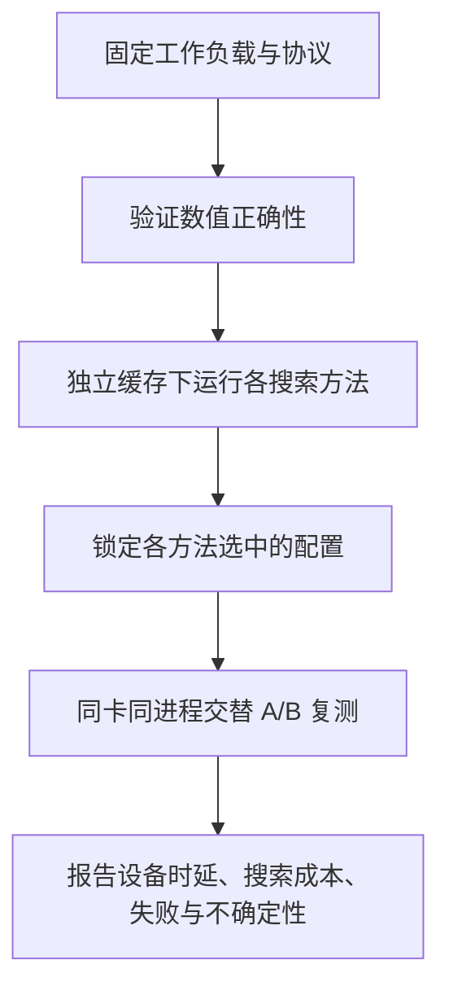

“这个配置快了 5%。”在 GPU 算子调优中，这句话首先是一个测量问题：测的是一次设备运算、Python 调用，还是编译和搜索？输入在 L2 中吗？两边是否使用同一种计时器？

这篇笔记来自一次 FlagGems／FlagTune 的 MetaX C500 实验，以及之后对 FlagTree、Helion 和 Triton 计时源码的复查。目标是建立一个可以固定、核查和复现的流程。文中的源码结论限定于列出的版本；历史实测、源码推断和建议协议分别说明。

## 先固定问题，再固定计时器

我们需要三个独立指标：

| 指标 | 回答的问题 | 边界 |
|---|---|---|
| 完整 GPU 运算时延 | 编译完成后，这个运算执行多快？ | 包含该运算所需的所有 kernel、归并和 GPU 依赖 |
| 主机端调用成本 | 应用调用这段代码花多少时间？ | 明确是否包含 Python、分配、提交及同步 |
| 调优总墙钟 | 为选出配置，实际等待多久？ | 包含选点、模型推断、编译、正确性检查、预热、计时和失败 |

不能把 split-K 的 partial kernel 时间当作完整矩阵乘法，也不能把搜索时间减少理解为最终 kernel 同比例提速。相同输入、dtype、布局、累加精度、输出语义与正确性标准是比较的起点。

## “官方 benchmark”也有多个入口

核查的 FlagGems 版本为 `2d50c88c91e590ec8246c0ea20977aaeef9edd85`，FlagTree Python 源码为 `2dc31aecc883ab04c8f7a1c1dab8b321ae8ed109`。

[FlagGems 的 benchmark/base.py](https://github.com/flagos-ai/FlagGems/blob/2d50c88c91e590ec8246c0ea20977aaeef9edd85/benchmark/base.py) 中：

- `OPERATOR` 用同步包围 Python 调用循环，包含主机调用和提交等成本。
- 普通非 Ascend 的 `KERNEL` 进入 `triton.testing.do_bench`；实际行为还要看所安装的 Triton／厂商 fork。
- `CUDAGRAPH` 使用 graph replay，减少主机逐次提交造成的影响。
- `WRAPPER` 的墙钟区间偏向主机提交成本，不能与同步完成的运算时间混用。

FlagTune 的 `pretune` 则执行选配置与选中配置复测；[rebench](https://github.com/flagos-ai/FlagGems/blob/2d50c88c91e590ec8246c0ea20977aaeef9edd85/src/flag_gems/flagtune/offline/cli/rebench.py) 将两边选中的固定配置放在同进程、同设备交替测量。该版本默认 9 trials × 3 sweeps，最终采用 sweep 内中位数再跨 sweep 取中位数。

这些工具服务于不同的问题。仅仅记录“使用官方 bench”，信息仍然不足。

## 一次具体纠正：记录了 warmup，不代表执行了相同的 warmup

最初，我们把回执中的 `warmup_ms=25` 理解为“实际预热了 25 毫秒”。复查源码后，这个描述需要纠正。

固定版本的 [benchmark_protocol.py](https://github.com/flagos-ai/FlagTree/blob/2dc31aecc883ab04c8f7a1c1dab8b321ae8ed109/python/triton/flagtune/runtime/benchmark_protocol.py) 在普通 graph-replay 路径中向底层传入 `rep`、`quantiles` 和可选的 `n_retries`，没有传入 `warmup_ms`。对应版本的 [do_bench_cudagraph](https://github.com/flagos-ai/FlagTree/blob/2dc31aecc883ab04c8f7a1c1dab8b321ae8ed109/python/triton/testing.py) 也没有 warmup 参数：它执行初始调用、五次估时、graph capture，随后测量 replay。

所以，这条源码路径上的字段值不能证明实际进行了等时长预热。随文提供了一个[无需 GPU 的参数转发探针](/assets/gpu-benchmark-protocol/probe_dispatch.py)，通过替换底层 timer、记录传入参数，复查这一点。它验证的是 wrapper 的转发行为，不能证明 GPU 已进入稳定温度或频率。

历史实机使用的是官方分发 wheel 加固定版本 FlagTune Python 子模块，未从完整 FlagTree 提交构建。因此上述本地源码核查仍不能替代对历史 wheel 函数体的核对。下次运行必须保存实际安装函数的源码或文件哈希。这是当前证据的明确限制。

## 缓存至少有三个不同层次

**编译缓存**决定是否重新编译。**调优数据库缓存**可能直接返回已有最佳配置或候选时延。**GPU 数据缓存**影响输入是否从 L2 等层级读取。

“冷编译缓存”和“热 L2”完全可以同时存在。对两个方法设置独立数据库，也不意味着它们的编译缓存独立。

固定版本 Triton 普通 `do_bench` 在每次正式计时前清缓存，而 graph-replay 路径没有同样的逐调用清 L2 操作。实际缓存驻留还依赖工作集大小，不能保证所有数据都在 L2。两种模式可能改变绝对时间，也可能改变最优配置的排序。

同样，先执行正确性测试可能预热编译缓存。若要测冷编译搜索成本，正确性预检应使用独立缓存目录；应用可控缓存与驱动内部缓存也应区分。

## 一个有用、但范围有限的实测例子

2026 年 10 月 24 日，我们在一张 64GB MetaX C500 上测试 `1024×1024 @ 1024×1024` 的连续 BF16 矩阵乘法，输出 BF16、内部 FP32 累加。环境为 PyTorch `2.8.0+metax3.7.0.7`，官方 FlagTree wheel `0.7.0.post2+metax3.6`，加上述固定 FlagTune Python 模块。

Default 的官方回执给出选中配置独立复测约 **32.535 µs**、调优阶段约 **2.203 s**。配置为 `BLOCK_M=64, BLOCK_N=64, BLOCK_K=32, num_warps=4, num_stages=2, pipeline=cpasync`。此前执行过正确性测试，因此不能把 2.203 秒称为冷编译搜索成本。

扩展空间原始枚举 2160 个配置；对该 shape 调用固定官方剪枝函数得到 430 个。采集在 10 分钟预算结束时停止，数据库中有 424 条记录：371 条有限时延、53 条非有限时延，另有 6 个缺测。最终完整 worker 回执未生成，随文数据是从官方 SQLite BenchmarkCache 只读导出的派生记录。

| 仅改变一个字段，其余与锚点相同 | 同一轮探索采集中的时延 |
|---|---:|
| 锚点配置 | 32.516 µs |
| BLOCK_K：32 → 64 | 54.787 µs |
| num_warps：4 → 8 | 51.147 µs |
| num_stages：2 → 3 | 39.080 µs |

这有助于形成假设：更大分块、更多并行、更深流水都可能付出资源代价。但是这些邻居尚未逐一独立复测和数值验证，不能据此断言具体瓶颈。有限时延也不等于数值正确；非有限时延不能一概解释为数学非法。

Default 选择的配置恰好是已测子集中最快的配置。因为存在缺测，不能称全空间最优。

我们还用官方 rebench 做了同一配置与自身的 A/A：报告吞吐比约 100.003%，相对吞吐的 sweep spread 约 0.026%。这是该案例的重复性检查，**不是置信区间，也不证明不存在系统偏差**。

[下载去除机器与账户信息的配置记录](/assets/gpu-benchmark-protocol/c500-mm-exploration.csv)，以及[版本、限制和校验哈希](/assets/gpu-benchmark-protocol/provenance.json)。这是一份单设备、单 shape 的探索记录。

## 搜索最小值必须独立复测

从很多带噪声的配置中选最小值，会同时选中一部分有利噪声。独立复测的作用是重新评价选中的配置。



可沿用官方交替复测，再增加按完整运行配对的重复实验。不能把 27 个内部时延读数当成 27 次独立搜索，也不能只保留成功 seed。失败、超时、重复建议和回退状态都属于结果。

## 如何和 Helion、Triton、CUTLASS 比较

Helion 的普通计时路径也有 event 与清 L2 操作，同时存在 graph 和后端特定路径。本文核查本地官方提交 `554daa4f37ac0d19573c8139b2fd3b7b714da037`；调用方可以覆盖默认参数，不能只看一个函数签名。[对应源码](https://github.com/pytorch/helion/blob/554daa4f37ac0d19573c8139b2fd3b7b714da037/helion/autotuner/benchmarking.py)

Helion 的 [LFBO 文章](https://pytorch.org/blog/accelerating-autotuning-in-helion/) 报告的是相对其原搜索方法的改进：B200 调优时间减少 36.5%、kernel 延迟降低 2.6%；MI350 分别为 25.9% 和 1.7%。这些数字不是 Helion 相对 FlagOS 的速度。

比较实现时，应在双方都支持的同一硬件上，把编译完成、正确的完整运算交给共同计时器。比较搜索策略时，则固定同一个 kernel 和候选空间，只替换候选建议方法。CUTLASS 的实例集合、厂商 BLAS 的精度及调度设置也要记录，不能通过统一时间单位消除这些差异。[CUTLASS Profiler](https://docs.nvidia.com/cutlass/latest/media/docs/cpp/profiler.html)

## 一份可以锁定的协议

下面是设计示例，不是某个工具已经实现的配置格式：

```yaml
protocol_id: mm-study-v1
workload:
  operator: mm
  shape: [1024, 4096, 4096]  # M, N, K
  dtype: bfloat16
  layout: contiguous
measurement:
  scope: complete_gpu_operation
  implementation_sha256: REQUIRED
  warmup_behavior: VERIFIED_FROM_INSTALLED_CODE
  mode: graph_replay
  l2_policy: no_explicit_flush_between_replayed_calls
  requested_measurement_ms: 100
  replay_samples: 10
search:
  max_unique_evaluations: 32
  max_wall_seconds: 300
  count_failures: true
  jit_cache: isolated_per_run
  tuning_database: isolated_per_run
validation:
  interleaved_trials: 9
  sweeps: 3
  save_raw_samples: true
```

锁定之前，应核实实际 GPU、路由、完整调用范围、计时器实现、候选域和模型身份。若 graph 不支持、计时器回退、模型未加载而回退到 Default，运行必须显式报告，不能继续挂着原来的标签。

协议需要被执行器检查。源码、候选、模型、计时器或预算一旦改变，就生成新协议版本并重跑基线；保留旧回执。profiling 插桩与硬件计数器采集单独进行，其时延不进入常规性能验收。

下一步最有用的实验，是同一卡上将 Default、选中的候选和原生 `torch.mm` 的实际完整调用交给共同计时器，分别测 graph replay 与清 L2 场景。只有这些边界清楚，才值得讨论几微秒的差异来自更好的搜索，还是更换了测量问题。

## 补充：11 月 9 日的短时真机诊断

为核查实际安装行为，我们另租了一台 16GB C500，镜像中的 PyTorch 为 `2.8.0+metax3.7.0.7`、Triton 为 `3.0.0`。这是新的计时诊断环境，不能用来替代前述 64GB MM 的历史环境。

预检遇到了两个真实问题：该 graph timer 不接受 `quantiles` 参数，并要求调用方使用非默认 stream。改用双方支持的 `return_mode="median"`，并为 graph 显式设置 side stream 后，诊断通过。

测试对象是预分配输出的 FP32 `torch.add`，共 1,048,576 个元素，先与 CPU 结果作精确比较；三个 sweep 的顺序为 event/graph、graph/event、event/graph。event 请求 warmup=5ms、rep=20ms；graph 请求 rep=20ms，使用自身固定预热与内部重复机制。两边协议有意保持可见，未宣称完全相同。

| timer | 三轮返回值的中位数 |
|---|---:|
| event | 38.912 µs |
| graph | 10.386 µs |

同一个运算出现约 3.75 倍的数值差异，说明计时场景足以显著改变报告值。这里同时改变了缓存、graph 调用方式、stream 和采样机制，不能把差异全部归因于缓存，更不能称作算子实现或框架加速。仅三轮也不足以建立稳定的性能排名。

[下载实测 JSON](/assets/gpu-benchmark-protocol/gpu-timer-result-20261109.json) 与[实际运行脚本](/assets/gpu-benchmark-protocol/gpu_timer_diagnostic.py)。JSON 含每轮原始返回值、调用参数、版本、可见显存、函数签名及源码 SHA-256。脚本执行前需按环境设置 MACA／运行时路径。这个新镜像的检查仍不能证明历史 3.6 wheel 的函数行为。


*本文由作者提出问题并指导方向，使用 AI 辅助整理、源码核查与写作。历史 MM 结果于 2026-10-24 采集，补充计时诊断于 2026-11-09 完成。*
